# FirmAgent-P2IM

**Agent-Guided Bare-Metal MCU Firmware Fuzzing on P2IM with Shared-SRAM Slice Auditing and Blind-Test Verification**

基于 Pi SDK (`0.85.1`) 与 P2IM 的裸机 MCU 固件 Agent 协同模糊测试框架：在不修改原版固件 ELF 字节的前提下，通过两段式“探索 → 共享 SRAM 数据流切片审计 → 受控协议种子与越界假设提案 → 确定性重放与字节消融验证 → 盲测隔离离线计分”闭环，打通全部 10 个 P2IM 基准固件的可运行性与可复现研究流程。

---

## Key Mechanisms / 核心技术改造

1. **Zero-ELF-Patch 10/10 Compatibility (`tools/p2im_oracle.py`, `patches/p2im-qemu-auto-forkserver.patch`)**
   - Unmodified benchmark ELFs are copied byte-for-byte and pinned by SHA256 before execution.
   - **Auto-forkserver hook (`P2IM_AUTO_FORKSERVER_PC`)**: Opt-in QEMU translation-block trigger invokes `startForkserver` once when an unmodified binary has `0` `svc #0x3f` instructions (`Soldering_Iron.elf`).
   - **Peripheral code-fetch guard (`PM_EXEC_PERI = 0x72`)**: Prevents instruction fetches at corrupted MMIO-range pointers (`0x40000000..0x5fffffff`) from triggering model-extraction abort loops.
   - **Dual initial seeds & verified board mapping**: Writes a 4-byte `seed-short` alongside `seed-random` to avoid immediate AFL dry-run crash aborts (`Reflow_Oven`), and maps `CNC` to `STM32F429I-Discovery` / `STM32F429ZI` where P2IM peripheral modeling hooks are active.
2. **Closed-Loop Two-Segment Agent Orchestration (`src/campaign/mcu-runtime.ts`)**
   - Replaces idle open-ended loops with a budgeted pipeline governed by `RunGovernance` (strict request/token/wall-clock caps and no silent fallback between providers).
3. **Interrupt-to-Main Shared-SRAM Dataflow Slicing (`tools/p2im_oracle.py`)**
   - Extracts peripheral Data Register (`DR`) reads across all modeling rounds using actual `reg_size` stride (`base + index * reg_size`) and `c++filt` symbol alignment.
   - Combines thumb literal-pool cross-referencing with byte-indexed store reach (`indexed_reach`) to associate ISR ring-buffer writers and main-loop consumers—including adjacent global overflows such as `slave` overwriting `rx_callback`—with `call_edge: false` (never fabricating call edges).
4. **Strict Blind-Test Isolation & Five-Level Verification (`L1–L5`, `scripts/score_l5.py`, `scripts/leak_check.py`)**
   - Agent prompts, tool envelopes, and analysis slices are hard-asserted free of `CVE-`/`CWE-`/`Table 5` truth-set tokens (`assertNoLeak`).
   - Offline host scorer `score_l5.py` runs only after all Agent sessions terminate, splitting verified `L4` candidates into `known_p2im_bug_direct`, `known_p2im_bug_downstream` (upstream shared-SRAM corruption root cause), and `unmatched_verified_candidate`.

---

## Architecture / 运行架构

```mermaid
flowchart LR
    P[prepare + model<br/>ELF SHA256 lock + me round 0] --> S1[discover_seg1<br/>Bounded P2IM + AFL exploration]
    S1 --> SL[slice<br/>DR reads + callgraph + shared SRAM / indexed_reach]
    SL --> AN[analyze_and_propose<br/>Pi main session reads paths.json,<br/>submits CRC16/raw seeds & hypotheses]
    AN --> S2[discover_seg2<br/>AFL resumes with admitted proposed-seeds]
    S2 --> TV[triage_and_verify<br/>3x deterministic replay + Contrast ablation]
    TV --> L14[score-owned.json + l5-candidates.json<br/>L1..L4 host evidence]
    L14 -. Separate offline host process after Agent exits .-> L5[scripts/score_l5.py<br/>L5: direct / downstream / unmatched]
```



---

## Benchmark Targets (Unpatched Original ELFs)

All 10 unpatched binaries are fetched from upstream public repositories and verified by SHA256 in [`docs/P2IM_10_UNPATCHED_MANIFEST.json`](docs/P2IM_10_UNPATCHED_MANIFEST.json):

| Target | Board / MCU | `svc 0x3f` | Unpatched ELF SHA256 (prefix) | Special Handling |
|---|---|---:|---|---|
| `PLC` | `STM32F429I-Discovery` / `STM32F429ZI` | 1 | `783108cf8b9c…` | Upstream `slave` -> `rx_callback` shared-SRAM slice |
| `CNC` | `STM32F429I-Discovery` / `STM32F429ZI` | 1 | `b5eb4e58c9a1…` | Empirical P2IM board lock (`STM32F4-Discovery` yields 0 DR) |
| `Gateway` | `NUCLEO-F103RB` / `STM32F103RB` | 1 | `53a61a7b9baa…` | Standard `svc 0x3f` |
| `Reflow_Oven` | `NUCLEO-F103RB` / `STM32F103RB` | 1 | `be996b5bba1a…` | Requires 4B `seed-short` beside `seed-random` to clear AFL dry-run |
| `Robot` | `NUCLEO-F103RB` / `STM32F103RB` | 1 | `724ea82d567b…` | Standard `svc 0x3f` |
| `Drone` | `NUCLEO-F103RB` / `STM32F103RB` | 1 | `8cd6a8437713…` | Standard `svc 0x3f` |
| `Console` | `FRDM-K64F` / `MK64FN1M0VLL12` | 1 | `216bbd526c70…` | 1-byte UART `reg_size` register stride |
| `Heat_Press` | `Arduino-Due` / `SAM3X8E` | 1 | `c4ad16410993…` | `stm32-boards.c` machine table (`CONFIG_SAM=n`) |
| `Steering_Control` | `Arduino-Due` / `SAM3X8E` | 1 | `917cf289ecb2…` | `stm32-boards.c` machine table (`CONFIG_SAM=n`) |
| `Soldering_Iron` | `NUCLEO-F103RB` / `STM32F103RB` | **0** | `44a6f0e31a61…` | From `hoedur-experiments`; uses `P2IM_AUTO_FORKSERVER_PC=0x08000268` |

---

## 5-Step Quickstart (Ubuntu 22.04/24.04 or WSL2 Ubuntu 24.04)

> **Important**: Run all commands on a **Linux native ext4 filesystem** with a short `work_root` such as `/tmp/fa-p2im` (required by P2IM AFL's `< 100`-byte `-c` path limit and to avoid NTFS/9p `fsync` issues on `/mnt/*`).

1. **Install OS prerequisites & Node.js >= 22.19.0**:
   ```bash
   sudo apt-get update && sudo apt-get install -y \
     build-essential git pkg-config python3 psmisc binutils-arm-none-eabi \
     libglib2.0-dev libpixman-1-dev libfdt-dev zlib1g-dev libjansson-dev gdb-multiarch
   ```
2. **Clone this repository on Linux native ext4, fetch pinned upstreams (`RiS3-Lab/p2im` + `hoedur-experiments`), compile AFL & patched QEMU, verify all 10 ELFs, and generate `configs/m3/*.json`**:
   ```bash
   git clone https://github.com/MagicSpirit007/firmagent-p2im.git ~/firmagent-p2im
   cd ~/firmagent-p2im
   bash scripts/setup_upstreams.sh
   ```
3. **Install Node dependencies, compile TypeScript, and run offline verification + privacy audit**:
   ```bash
   npm ci && npm run build
   npm test
   npm run test:py
   npm run verify:privacy
   ```
4. **Run zero-LLM baseline (`B0` stock P2IM segment or `--mode offline` full `L1–L4` loop)**:
   ```bash
   python3 tools/p2im_oracle.py prepare --target PLC \
     --elf "$HOME/deps/p2im/externals/p2im-real_firmware/binary/PLC" \
     --expect-sha256 783108cf8b9cf7f703a4164dfee7d12d9a9f79d663328a21454a70a7003c2b08 \
     --work-root /tmp/fa-p2im-b0
   python3 tools/p2im_oracle.py fuzz --target PLC --segment s1 --seconds 60 --work-root /tmp/fa-p2im-b0
   # Or run full TypeScript offline pipeline (model_requests = 0):
   node dist/src/cli.js mcu-p2im --config configs/m3/plc.json --out runs/plc-offline --mode offline
   ```
5. **Run with DeepSeek LLM + offline post-hoc `L5` scoring**:
   ```bash
   export DEEPSEEK_API_KEY="<your-deepseek-api-key>"   # never commit or log keys
   node dist/src/cli.js doctor --provider deepseek --model deepseek-v4-flash
   node dist/src/cli.js mcu-p2im --config configs/m3/plc.json --out runs/plc-real --mode real \
     --provider deepseek --model deepseek-v4-flash --model-calls 16 --max-total-tokens 150000
   # After the run completes, score L5 in a separate offline process:
   python3 scripts/score_l5.py \
     --notes "$HOME/deps/hoedur-experiments/02-coverage-est-data-set/binary-patching/P2IM_patching_notes.md" \
     --candidates runs/plc-real/l5-candidates.json --target PLC --summary-only --out runs/plc-real/l5.json
   ```

For detailed step-by-step instructions, multi-seed evaluation protocols, troubleshooting, and artifact schemas, read:
- **完整可复现实验手册 / Full Reproducibility Guide**: [`docs/REPRODUCIBILITY.md`](docs/REPRODUCIBILITY.md)
- **相对上游的全部修改清单 / Changelog from Upstream P2IM**: [`docs/CHANGELOG_FROM_UPSTREAM.md`](docs/CHANGELOG_FROM_UPSTREAM.md)
- **QEMU 重建说明 / QEMU Build Notes**: [`docs/BUILD_QEMU.md`](docs/BUILD_QEMU.md)

---

## Repository Structure

```text
firmagent-p2im/
├── README.md
├── LICENSE                              # MIT + Apache-2.0 / GPL-2.0 third-party notices
├── package.json / package-lock.json     # Node >=22.19.0, @earendil-works/pi-{coding-agent,ai} 0.85.1
├── tsconfig.json
├── src/                                 # TypeScript Pi campaign runtime (mcu-p2im mode)
│   ├── cli.ts                           # Entrypoint: mcu-p2im, doctor
│   ├── contracts.ts / pi-model-runtime.ts / core/session.ts
│   └── campaign/{governance,owned-process,tools,mcu-types,mcu-oracle,mcu-tools,mcu-runtime,mcu-cli}.ts
├── tools/
│   └── p2im_oracle.py                   # Host P2IM oracle, DR extractor, shared-SRAM slicer, replay & contrast
├── patches/
│   ├── p2im-qemu-auto-forkserver.patch  # 16-file QEMU patch (P2IM_AUTO_FORKSERVER_PC, PM_EXEC_PERI 0x72, Py3.12, --disable-sdl)
│   └── p2im-python312-scripts.patch     # Python 3.12 ConfigParser + wsl_compat + 0x72 non-retry for fuzz.py/me.py/cov.py
├── p2im-shim/wsl_compat.py              # Linux/WSL2 AFL env & line-buffering shim
├── scripts/
│   ├── setup_upstreams.sh               # Automated pinned fetch, compile, patch, ELF SHA256 verify & config gen
│   ├── generate_configs.py              # Emits configs/m3/<target>.json with <100B -c check
│   ├── score_l5.py                      # Offline L5 scorer (direct / downstream / unmatched)
│   ├── leak_check.py                    # Blind-test token scanner
│   └── privacy_audit.py                 # Pre-publish secret/path hygiene scanner
├── configs/pi-agent-example/models.json # Non-secret DeepSeek endpoint template
├── docs/
│   ├── P2IM_10_UNPATCHED_MANIFEST.json  # Verified metadata & SHA256 digests for all 10 ELF targets
│   ├── REPRODUCIBILITY.md               # Step-by-step Chinese reproducibility manual
│   ├── CHANGELOG_FROM_UPSTREAM.md       # Full diff accounting over stock P2IM & legacy FirmAgent
│   └── BUILD_QEMU.md
└── test/                                # Node.js TS unit tests + Python unittest suites
```
