# FirmAgent-P2IM

**Agent-Guided Bare-Metal MCU Firmware Fuzzing on P2IM with Shared-SRAM Slice Auditing and Blind-Test Verification**

基于 Pi SDK (`0.85.1`) 与 P2IM 的裸机 MCU 固件 Agent 协同模糊测试框架：在不修改原版固件 ELF 字节的前提下，通过两段式“探索 → 共享 SRAM 数据流切片审计 → 受控协议种子与越界假设提案 → 确定性重放与字节消融验证 → 盲测隔离离线计分”闭环，打通全部 10 个 P2IM 基准固件的可运行性与可复现研究流程。

---

## Key Mechanisms / 核心技术改造

1. **Zero-ELF-Patch 10/10 Compatibility (`tools/p2im_oracle.py`, `patches/p2im-qemu-auto-forkserver.patch`)**
   - Unmodified benchmark ELFs are copied byte-for-byte and pinned by SHA256 before execution.
   - **Auto-forkserver hook (`P2IM_AUTO_FORKSERVER_PC`)**: Opt-in QEMU translation-block trigger invokes `startForkserver` once when an unmodified binary has `0` `svc #0x3f` instructions (`Soldering_Iron.elf`).
   - **Peripheral code-fetch guard (`PM_EXEC_PERI = 0x72`)**: Prevents instruction fetches at corrupted MMIO-range pointers (`0x40000000..0x5fffffff`) from triggering model-extraction abort loops.
   - **Dual initial seeds & verified board mapping**: Writes a 4-byte `seed-short` alongside `seed-random` to avoid immediate AFL dry-run crash aborts (`Reflow_Oven`), and maps `CNC` to `STM32F429I-Discovery` / `STM32F429ZI` where P2IM peripheral modeling hooks are active.
2. **Closed-Loop Two-Segment Agent Orchestration (`src/campaign/mcu-runtime.ts`)**
   - Replaces idle open-ended loops with a budgeted pipeline governed by `RunGovernance` (strict request/token/wall-clock caps and no silent fallback between providers).
3. **Interrupt-to-Main Shared-SRAM Dataflow Slicing (`tools/p2im_oracle.py`)**
   - Extracts peripheral Data Register (`DR`) reads across all modeling rounds using actual `reg_size` stride (`base + index * reg_size`) and `c++filt` symbol alignment.
   - Combines thumb literal-pool cross-referencing with byte-indexed store reach (`indexed_reach`) to associate ISR ring-buffer writers and main-loop consumers—including adjacent global overflows such as `slave` overwriting `rx_callback`—with `call_edge: false` (never fabricating call edges).
4. **Strict Blind-Test Isolation & Five-Level Verification (`L1–L5`, `scripts/score_l5.py`, `scripts/leak_check.py`)**
   - Agent prompts, tool envelopes, and analysis slices are hard-asserted free of `CVE-`/`CWE-`/`Table 5` truth-set tokens (`assertNoLeak`).
   - Offline host scorer `score_l5.py` runs only after all Agent sessions terminate, splitting verified `L4` candidates into `known_p2im_bug_direct`, `known_p2im_bug_downstream` (upstream shared-SRAM corruption root cause), and `unmatched_verified_candidate`.

### Why & What Changed: From Linux FirmAgent & Stock P2IM to Bare-Metal `firmagent-p2im`

| Problem / Bottleneck | Mechanism Introduced (File / Symbol) | Observable Before -> After |
|---|---|---|
| Stock `RiS3-Lab/p2im` (`0e64506a`) fails on Ubuntu 24.04 / Python 3.12 (`SafeConfigParser` removed, 2017 `libglib` mismatch, unscoped `killall`, WSL2 AFL checks, `<100B` `-c` abort on `s2` seeds) | `patches/p2im-python312-scripts.patch` (`ConfigParser`, `--model-if` continuity, `--skip-seed-prefix`, scoped cleanup), `p2im-shim/wsl_compat.py`, `unset LD_LIBRARY_PATH` QEMU shim, `<100B` short `inputs-s2` mapping (`b00`/`q0000`/`p00`) | **Before**: Immediate import/link aborts, `s2` `MODEL_IF_LEN=100` `PROGRAM ABORT`, or model resets<br>**After**: Deterministic builds, cumulative `0.s2` model continuity, `0`-stray process sweeps, verified offline TS + Python suites |
| Unpatched `Soldering_Iron.elf` (`44a6f0e3…`) has `0` `svc #0x3f` calls, so stock QEMU never starts AFL forkserver | Opt-in `p2im_maybe_auto_forkserver` gated by `P2IM_AUTO_FORKSERVER_PC=0x08000268` (`target-arm/translate.c`, `cpu-exec.c`); no-op when unset | **Before**: `0` models, `p2im_runnable=false` (9/10 targets)<br>**After**: Zero ELF edits; `Soldering_Iron` hits `start up afl forkserver!` (`13` peripherals, `33` DR, `60.066s` fuzz window) |
| Corrupted callback pointers jumping into MMIO (`0x40000000..0x5fffffff`) trigger bogus unmodeled-peripheral retries (`0x40`); wrong `CNC` board or 256B `Reflow_Oven` dry-run aborts | `PM_EXEC_PERI = 0x72` guard + `pm_fetching_code` (`cputlb.c`, `memory.c`) + `no_retry` + `exec_peri` crash replay parser; lock `CNC` to `STM32F429I-Discovery`; dual `seed-short` (`0\n\x00\x00`) beside `seed-random` | **Before**: `me.py` retry loops; `CNC` `0` DR (`-11`); `Reflow_Oven` `0` execs `PROGRAM ABORT`<br>**After**: Deterministic `0x72` crash capture; `CNC` `39` DR (`2926` execs/60s); `Reflow_Oven` `2582` execs/60s |
| ISR-to-main communication crosses global SRAM buffers (`slave` -> `rx_callback`) without a direct call edge; downstream callback crashes obscure upstream root causes | `DISASM_PARSER_VERSION = 3` (`add` mnemonic + literal pools), `indexed_member_sites` / `indexed_reach` (`call_edge: false`), `sharedViaRank` (`mcu-runtime.ts`), `admit-seed` CRC16 gate, 5-target ELF-backed `score_l5.py` (`unique_bugs` deduplication) | **Before**: Missing `Modbus::process_FC1` upstream link; blind `L5` on inline-formatted targets (`CNC`/`Heat_Press`/`Soldering_Iron`)<br>**After**: Full 5-target (12-bug) truth resolution, `L2>=L3>=L4` fingerprint deduplication, and `unique_bugs` deduplicated `L5` attribution (`0` truth leakage) |

---

## Architecture / 运行架构

```mermaid
flowchart LR
    P[prepare + model<br/>ELF SHA256 lock + me round 0] --> S1[discover_seg1<br/>Bounded P2IM + AFL exploration]
    S1 --> SL[slice<br/>DR reads + callgraph + shared SRAM / indexed_reach]
    SL --> AN[analyze_and_propose<br/>Pi main session reads paths.json,<br/>submits CRC16/raw seeds & hypotheses]
    AN --> S2[discover_seg2<br/>AFL resumes with admitted proposed-seeds]
    S2 --> TV[triage_and_verify<br/>3x deterministic replay + Contrast ablation]
    TV --> L14[score-owned.json + l5-candidates.json<br/>L1..L4 host evidence]
    L14 -. Separate offline host process after Agent exits .-> L5[scripts/score_l5.py<br/>L5: direct / downstream / unmatched]
```



---

## Benchmark Targets (Unpatched Original ELFs)

All 10 unpatched binaries are fetched from upstream public repositories and verified by SHA256 in [`docs/P2IM_10_UNPATCHED_MANIFEST.json`](docs/P2IM_10_UNPATCHED_MANIFEST.json):

| Target | Board / MCU | `svc 0x3f` | Unpatched ELF SHA256 (prefix) | Special Handling |
|---|---|---:|---|---|
| `PLC` | `STM32F429I-Discovery` / `STM32F429ZI` | 1 | `783108cf8b9c…` | Upstream `slave` -> `rx_callback` shared-SRAM slice |
| `CNC` | `STM32F429I-Discovery` / `STM32F429ZI` | 1 | `b5eb4e58c9a1…` | Empirical P2IM board lock (`STM32F4-Discovery` yields 0 DR) |
| `Gateway` | `NUCLEO-F103RB` / `STM32F103RB` | 1 | `53a61a7b9baa…` | Standard `svc 0x3f` |
| `Reflow_Oven` | `NUCLEO-F103RB` / `STM32F103RB` | 1 | `be996b5bba1a…` | Requires 4B `seed-short` beside `seed-random` to clear AFL dry-run |
| `Robot` | `NUCLEO-F103RB` / `STM32F103RB` | 1 | `724ea82d567b…` | Standard `svc 0x3f` |
| `Drone` | `NUCLEO-F103RB` / `STM32F103RB` | 1 | `8cd6a8437713…` | Standard `svc 0x3f` |
| `Console` | `FRDM-K64F` / `MK64FN1M0VLL12` | 1 | `216bbd526c70…` | 1-byte UART `reg_size` register stride |
| `Heat_Press` | `Arduino-Due` / `SAM3X8E` | 1 | `c4ad16410993…` | `stm32-boards.c` machine table (`CONFIG_SAM=n`) |
| `Steering_Control` | `Arduino-Due` / `SAM3X8E` | 1 | `917cf289ecb2…` | `stm32-boards.c` machine table (`CONFIG_SAM=n`) |
| `Soldering_Iron` | `NUCLEO-F103RB` / `STM32F103RB` | **0** | `44a6f0e31a61…` | From `hoedur-experiments`; uses `P2IM_AUTO_FORKSERVER_PC=0x08000268` |

---

## Reproduction Routes / 复现路径（手工详尽分步 vs 一键等价封装）

> **Important**: Run all commands on a **Linux native ext4 filesystem** with a short `work_root` such as `/tmp/fa-p2im` (required by P2IM AFL's `< 100`-byte `-c` path limit and to avoid NTFS/9p `fsync` issues on `/mnt/*`). Also set `echo core | sudo tee /proc/sys/kernel/core_pattern` on Ubuntu/WSL2 hosts before AFL dry-runs.

### Route A: Full Manual Step-by-Step Scientific Walkthrough (Recommended for Audits)

To inspect every change and verify each component without black-box wrappers, follow **Steps 1–9** in [`docs/REPRODUCIBILITY.md`](docs/REPRODUCIBILITY.md):
- **Steps 1–2**: Install host packages (`psmisc`, `binutils-arm-none-eabi`, `libjansson-dev`, Node `>=22.19.0`), configure `/proc/sys/kernel/core_pattern`, check out pinned `RiS3-Lab/p2im@0e64506a`, `p2im-real_firmware@d4c74565`, and `hoedur-experiments@2babc78b`, verify all 10 ELF SHA256 digests, and compare `svc 0x3f` counts via `arm-none-eabi-objdump`.
- **Steps 3–5**: Manually compile `afl-fuzz`, inspect (`git apply --stat`) and apply the 16-file QEMU patch, check the `CONFIG_STM32=y` / `CONFIG_KINETIS=n` invariant, build `qemu-system-gnuarmeclipse` with `-ljansson` & `nm` verification (`T p2im_maybe_auto_forkserver`), apply `p2im-python312-scripts.patch` + `wsl_compat.py` + `me` wrapper, and generate `configs/m3/*.json`.
- **Step 6**: Run the pre-build clean privacy gate (`npm run verify:privacy`), install & build TypeScript (`npm ci && npm run build`), run TS/Python contract suites (`npm test`, `npm run test:py`), optionally re-scan secrets (`python3 scripts/privacy_audit.py --ignore-build-artifacts`), and verify provider setup via read-only `node dist/src/cli.js doctor`.
- **Step 7 (Low-Level Dissection)**: Drive `tools/p2im_oracle.py` manually command-by-command (`prepare` -> `smoke` -> `me` -> `fuzz` -> `extract-sources` -> `slice-paths` -> `admit-seed` negative/positive CRC16 examples -> `crashes` -> `replay --repeat 3` -> `contrast` -> optional `gdb-watch`), inspect via `scripts/verify_step7.py`, plus side-by-side manual verification of `Soldering_Iron` (`--auto-forkserver-pc 0x08000268`) and `Reflow_Oven` (`seed-short`).
- **Steps 8–9**: Run controlled `--mode b0` (single-segment stock P2IM), `--mode offline` (`model_calls=0`), and `--mode real` (`DEEPSEEK_API_KEY`, `--thinking low --max-output-tokens 16384 --analyze-model-calls 6 --replay-model-calls 0`) campaigns with isolated `--work-root`s, then evaluate offline isolated `score_l5.py` + `leak_check.py` + `eval_arms.py compare` under the equal-wall-clock / equal-`execs_done` & unique BBL union protocol.

### Route B: 5-Step Automated Quickstart (`scripts/setup_upstreams.sh` Wrapper for Steps 1–5)

`scripts/setup_upstreams.sh` automates Manual Route Steps 1–5 end-to-end:

1. **Install OS prerequisites & Node.js >= 22.19.0**:
   ```bash
   sudo apt-get update && sudo apt-get install -y \
     build-essential git pkg-config python3 psmisc binutils-arm-none-eabi \
     libglib2.0-dev libpixman-1-dev libfdt-dev zlib1g-dev libjansson-dev gdb-multiarch
   echo core | sudo tee /proc/sys/kernel/core_pattern
   ```
2. **Clone this repository on Linux native ext4, fetch pinned upstreams (`RiS3-Lab/p2im` + `hoedur-experiments`), compile AFL & patched QEMU, verify all 10 ELFs, and generate `configs/m3/*.json`**:
   ```bash
   git clone https://github.com/MagicSpirit007/firmagent-p2im.git ~/firmagent-p2im
   cd ~/firmagent-p2im
   bash scripts/setup_upstreams.sh
   ```
3. **Run pre-build clean privacy gate, install Node dependencies, compile TypeScript, and run offline verification**:
   > Run `npm run verify:privacy` **before** `npm ci` (and do NOT delete `node_modules/` or `dist/` afterward; post-build secret scanning uses `--ignore-build-artifacts`).
   ```bash
   npm run verify:privacy
   npm ci && npm run build
   npm test
   P2IM_ROOT="$HOME/deps/p2im" HOEDUR_EXPERIMENTS_ROOT="$HOME/deps/hoedur-experiments" P2IM_NOTES="$HOME/deps/hoedur-experiments/02-coverage-est-data-set/binary-patching/P2IM_patching_notes.md" npm run test:py
   python3 scripts/privacy_audit.py --ignore-build-artifacts
   ```
4. **Run zero-LLM baselines (`--mode b0` stock P2IM or `--mode offline` full `L1–L4` loop) under equal `--fuzz-budget-s 1200` and paired `--seed 1707` with isolated `--work-root`s**:
   ```bash
   node dist/src/cli.js mcu-p2im --config configs/m3/plc.json --work-root /tmp/fa-b0 --out runs/plc-b0 --mode b0 --fuzz-budget-s 1200 --seed 1707 --collect-coverage true
   node dist/src/cli.js mcu-p2im --config configs/m3/plc.json --work-root /tmp/fa-off --out runs/plc-offline --mode offline --segment-seconds 300 --fuzz-budget-s 1200 --seed 1707 --collect-coverage true
   ```
5. **Run with DeepSeek LLM + offline post-hoc `L5` & multi-arm evaluation**:
   ```bash
   read -rsp "DEEPSEEK_API_KEY: " DEEPSEEK_API_KEY && export DEEPSEEK_API_KEY && echo
   node dist/src/cli.js doctor --provider deepseek --model deepseek-v4-flash
   node dist/src/cli.js mcu-p2im --config configs/m3/plc.json --work-root /tmp/fa-real --out runs/plc-real --mode real \
     --segment-seconds 300 --fuzz-budget-s 1200 --seed 1707 \
     --provider deepseek --model deepseek-v4-flash --thinking low \
     --max-output-tokens 16384 --analyze-model-calls 6 --replay-model-calls 0 \
     --model-calls 16 --max-total-tokens 160000 --collect-coverage true
   # After all Agent sessions exit, score deduplicated unique L5 bugs and compare B0 (bare vs +SRAM slice) vs offline vs real:
   python3 scripts/score_l5.py \
     --notes "$HOME/deps/hoedur-experiments/02-coverage-est-data-set/binary-patching/P2IM_patching_notes.md" \
     --candidates runs/plc-real/l5-candidates.json --target PLC --summary-only --out runs/plc-real/l5.json
   python3 scripts/eval_arms.py compare \
     --arm b0=runs/plc-b0 --arm offline=runs/plc-offline --arm real=runs/plc-real \
     --notes "$HOME/deps/hoedur-experiments/02-coverage-est-data-set/binary-patching/P2IM_patching_notes.md" \
     --markdown runs/plc-compare.md
   ```

For design rationales, Before/After evidence, multi-seed evaluation protocols, troubleshooting, and artifact schemas, read:
- **科研理据与完整分步复现手册 / Design Rationale & Manual Reproducibility Guide**: [`docs/REPRODUCIBILITY.md`](docs/REPRODUCIBILITY.md)
- **相对上游的全部改动清单 / Changelog from Upstream P2IM**: [`docs/CHANGELOG_FROM_UPSTREAM.md`](docs/CHANGELOG_FROM_UPSTREAM.md)
- **QEMU 重建说明 / QEMU Build Notes**: [`docs/BUILD_QEMU.md`](docs/BUILD_QEMU.md)

---

## Repository Structure

```text
firmagent-p2im/
├── README.md
├── LICENSE                              # MIT + Apache-2.0 / GPL-2.0 third-party notices
├── package.json / package-lock.json     # Node >=22.19.0, @earendil-works/pi-{coding-agent,ai} 0.85.1
├── tsconfig.json
├── src/                                 # TypeScript Pi campaign runtime (mcu-p2im mode)
│   ├── cli.ts                           # Entrypoint: mcu-p2im, doctor
│   ├── contracts.ts / pi-model-runtime.ts / core/session.ts
│   └── campaign/{governance,owned-process,tools,mcu-types,mcu-oracle,mcu-tools,mcu-runtime,mcu-cli}.ts
├── tools/
│   └── p2im_oracle.py                   # Host P2IM oracle, DR extractor, shared-SRAM slicer, replay & contrast
├── patches/
│   ├── p2im-qemu-auto-forkserver.patch  # 16-file QEMU patch (P2IM_AUTO_FORKSERVER_PC, PM_EXEC_PERI 0x72, Py3.12, --disable-sdl)
│   └── p2im-python312-scripts.patch     # Python 3.12 ConfigParser + wsl_compat + 0x72 non-retry for fuzz.py/me.py/cov.py
├── p2im-shim/wsl_compat.py              # Linux/WSL2 AFL env & line-buffering shim
├── scripts/
│   ├── setup_upstreams.sh               # Automated pinned fetch, compile, patch, ELF SHA256 verify & config gen
│   ├── generate_configs.py              # Emits configs/m3/<target>.json with <100B -c check
│   ├── verify_step7.py                  # Read-only Step 7 oracle workspace health verifier
│   ├── score_l5.py                      # Offline L5 scorer (direct / downstream / unmatched + bare vs SRAM split)
│   ├── eval_arms.py                     # Offline B0 vs offline vs real evaluator & multi-run comparator
│   ├── leak_check.py                    # Blind-test token scanner
│   └── privacy_audit.py                 # Pre-publish secret/path hygiene scanner (prunes build dirs)
├── configs/pi-agent-example/models.json # Non-secret DeepSeek endpoint template
├── docs/
│   ├── P2IM_10_UNPATCHED_MANIFEST.json  # Verified metadata & SHA256 digests for all 10 ELF targets
│   ├── REPRODUCIBILITY.md               # Step-by-step Chinese reproducibility manual
│   ├── CHANGELOG_FROM_UPSTREAM.md       # Full diff accounting over stock P2IM & legacy FirmAgent
│   └── BUILD_QEMU.md
└── test/                                # Node.js TS unit tests + Python unittest suites
```
